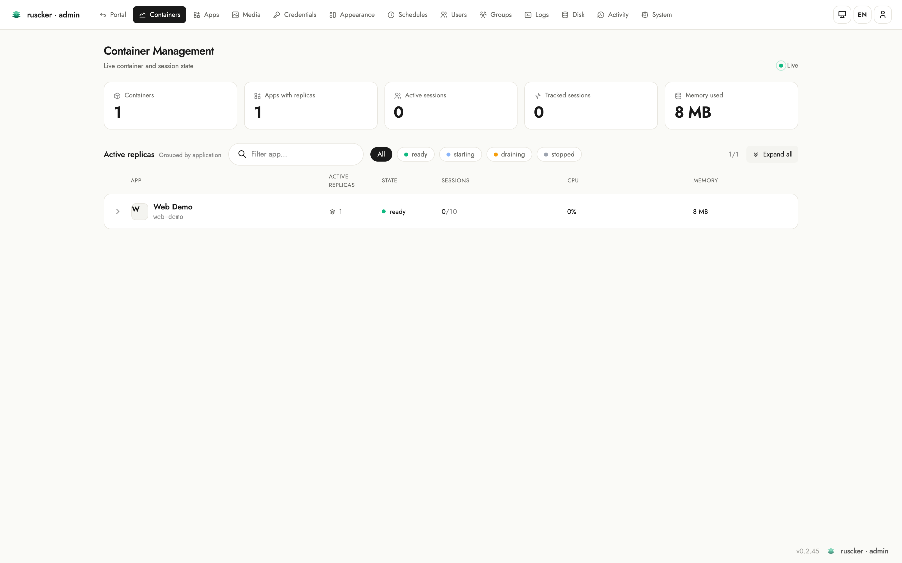
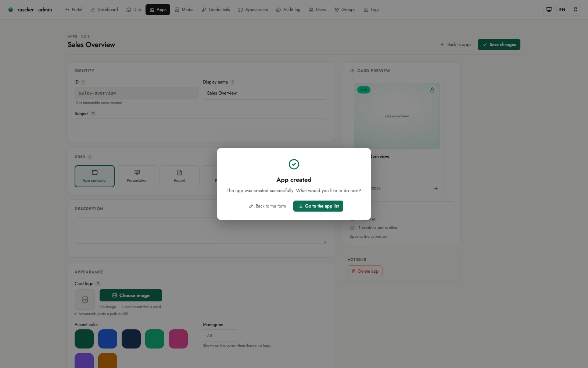
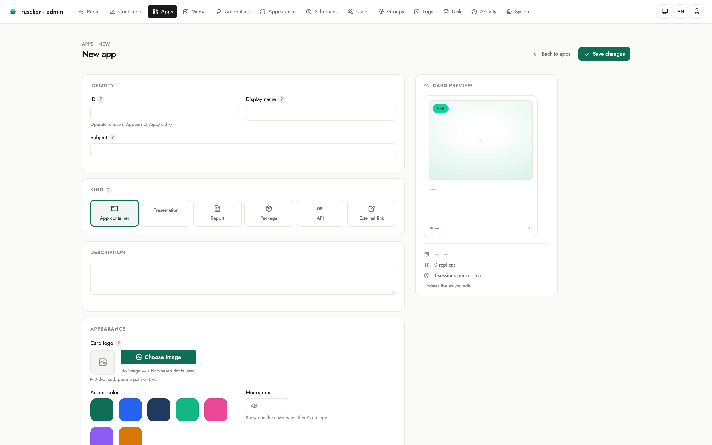
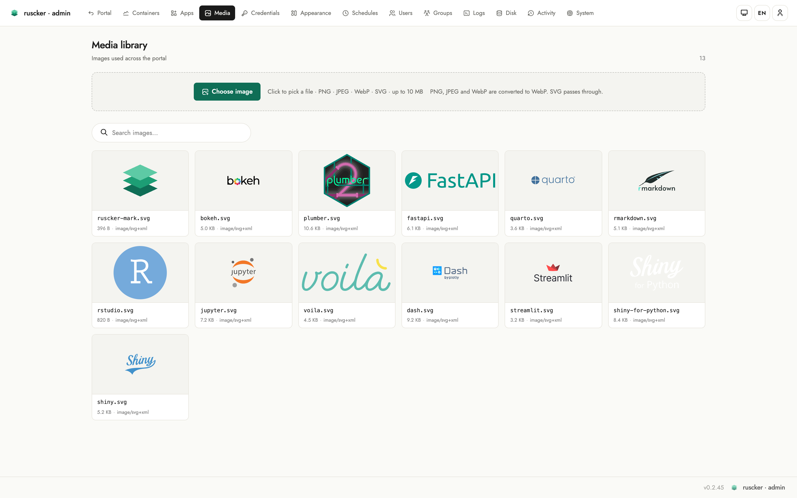
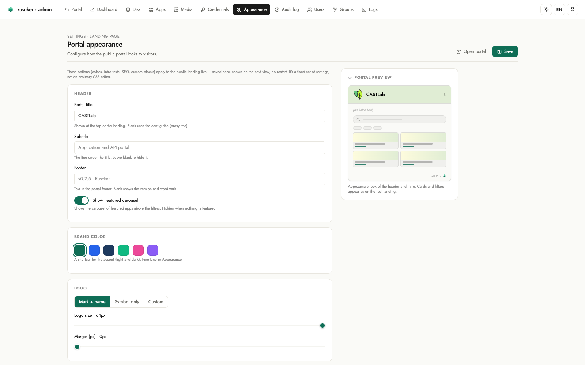

# The admin panel

The admin panel is Ruscker's main advantage over editing YAML by hand.
It lives at `/admin`, uses account login after token-based bootstrap,
and needs a catalog database: SQLite with `serve --db <file>`, or shared
Postgres with `--config-db-url` in HA.

**Everything is configurable from the web UI** — every spec field
(including API, scaling, resource and lifecycle settings), the media
library, encrypted credentials, and the whole landing page. YAML
import/export exists for migration and backups, not as a requirement.

The admin panel and the public portal both work on a phone: the top
navigation collapses to icons, wide tables and the dashboard's replica
grid scroll inside their cards (rather than stretching the page), and the
portal's app cards go full-width and show their whole description up front
— the desktop hover-to-expand isn't needed on touch.

## Logging in

On first run, set `RUSCKER_ADMIN_TOKEN` (the `.deb` generates one on
install and prints it once) and browse to `/admin/login`: with no
accounts yet you're asked for the **token**, then walked through
creating the first **admin account** (username + password). After that
everyone signs in with their account at `/admin/login`. The token stays
as a **break-glass** login (`/admin/login?token=1`) so you can never be
locked out. Until a token is set, `/admin/*` returns `503` and only the
public landing + proxy are served.

The sign-in page carries the **portal's own identity**: the title, the
header logo and the theme colours set under Appearance (with the
built-in mark when there is no custom logo). When a person arrives from
an [SSO client](#sso), it also says which system they are signing in
to, using the name and logo registered for that client. There is no
free-form HTML on this page, by design: it receives passwords.

After a few wrong passwords in a row the page answers **"Too many
attempts. Wait a moment and try again."** instead of checking the next
one. The wait starts at one second and doubles with each further
failure, up to five minutes; it applies to that account from that
network address, so one person mistyping does not slow anyone else
down, and nobody can lock the whole portal by failing on purpose. A
correct sign-in from an address is remembered for 30 days, and from
there the person is not affected by attacks on their account from
elsewhere. See [Troubleshooting](./troubleshooting.md#too-many-attempts-on-the-sign-in-page)
for what to do when someone is stuck, and
[Security](./security.md) for the exact limits.

Appearance → **Sign-in page** picks one of three layouts: **Card** (the
form in a centred card), **Split** (the form beside a panel with the
portal's brand and an optional image from the Media library; the panel
is hidden on narrow screens) and **Minimal** (the form alone).

The top-right account cluster has the same **language** (pt-BR / en-US /
es-ES / fr-FR) and **theme** (light / dark / auto) pickers as the public
portal, plus your current **access level** and account actions.

## Users and access levels (roles)

Each person gets their own account (username + password). Admins, and
Editors within the group boundary described below, manage accounts under
**Users** (`/admin/users`): create one, or open a row's **Edit** button for
the consolidated page — full name, role, groups and profile in one form
with a single save, plus the password reset. The **full name** is
optional; SSO clients receive it as the person's name (the username is
used when it is empty). Each row shows a coloured avatar with the
user's initials and their groups as coloured badges (a group keeps the same
colour on the Groups and Apps pages). The table is paginated on the server
at 50 users per page. Its server-side, case-insensitive search (accented
letters included — `GESTÃO` matches `Gestão`, though it does not strip
diacritics, so `Joao` won't find `João`) covers username, groups,
department, email and phone on both SQLite and Postgres. An Editor's totals,
search and pages all cover only accounts in that Editor's scope.

**Export CSV** (Admin-only, like the import) sits beside the search: *all*
ignores the search and writes every account, *filtered* (shown only while
a search is active, with its count) writes exactly the rows the search
matches across every page. Columns are the import's
(`username,role,password,groups,setor,email,celular` — `groups` joined
with `;`) plus `created_at`. The `password` column is always empty (hashes
never leave), so the file re-imports once you fill it in; free-text
fields that a spreadsheet would read as a formula are guarded with a
leading `'`, which the importer strips again. Each export writes a
`users.export` audit row with the scope, term and row count, never the
rows; if that row can't be written the export is refused.

Searching, sorting and paging **don't reload the page**: the table region
is fetched and swapped in place (debounced as you type), the URL is kept
in sync so a reload or a shared link reproduces the view, and the Back
button steps through the history. Sorting by user, role or created date
is **server-side** (`?sort=username|role|created&dir=asc|desc`), so it
orders the whole result, not just the visible page. The Audit and
Activity filters work the same way. Without JavaScript every form still
submits normally.

Passwords follow a **policy**: at least 8 characters, with at least one
uppercase letter, one lowercase letter, one digit and one special
character — enforced everywhere a password is set (create, reset,
first-admin setup, self-service change, CSV import). Existing passwords
aren't retroactively rejected; admin-assigned ones are transitional
anyway, because the user is asked to change theirs on first login. Next
to the password field, a **generate button** fills in a strong random
14-character password (created in your browser, policy-compliant, no
look-alike characters) and reveals it so you can read what you're about
to hand over — no more `teste123`. **Password fields are masked** (type
`password`) throughout the panel otherwise, so a shoulder-surfer can't
read a password as you type it.

| Role | Can do |
|---|---|
| **Viewer** | a **portal** account, not a panel operator: signs in to unlock group-restricted cards on the landing; reaches no admin section |
| **Editor** | manage Apps, Containers, Users and Group membership within their own groups; open apps and the Media library remain shared across Editors |
| **Admin** | unrestricted panel access, including every app, user and group plus credentials, the landing editor, custom blocks and the audit log |

The panel shows only the sections your role can reach. Enforcement is
server-side — hiding a nav link is just UX; the routes themselves
return `403` for a role that isn't allowed. When an Editor is allowed into
a section but asks for an app, user, group or replica outside their scope,
the handler returns `404`, deliberately making a forbidden target
indistinguishable from a missing one. The audit log records the acting
username. A **last-admin guard** stops you deleting or demoting the only
remaining admin (so the portal can't be locked out); the
`RUSCKER_ADMIN_TOKEN` break-glass login is the other safety net.

An Editor's scope is the exact, case-sensitive set of groups on their own
account, read from the database on every request:

- **Applications and Containers.** An Editor can see and operate every
  app whose `access-groups` overlaps their groups. Apps with neither
  `access-groups` nor `access-users` are **open** and remain global to every
  Editor. An app restricted only by `access-users` has no group boundary and
  is therefore Admin-only. The same rule protects app lists, direct app
  actions, YAML app imports, container details, logs, stop and restart.
  When editing a shared app, groups outside the Editor's scope stay attached
  but are not exposed as editable choices.
- **Users.** The list, search, pagination and KPIs include only non-Admin
  accounts sharing at least one group. An Editor may create Viewer or Editor
  accounts, but must assign at least one of their own groups; they may edit
  in-scope role, profile and membership and reset an in-scope user's
  password. They cannot target an Admin, assign the Admin role, edit
  themselves through the Users page, delete an account, import users from
  CSV or reset MFA. Memberships belonging to other groups survive an
  Editor's edit.
- **Groups.** An Editor sees only their groups and may add or remove
  non-Admin users from those memberships. Creating, renaming and deleting a
  group remain Admin-only.

Admin account sessions and the `RUSCKER_ADMIN_TOKEN` break-glass session are
unrestricted; group membership never narrows either one.

> **Before upgrading:** give every Editor account at least one group in the
> current release's **Users** page before starting the upgraded Ruscker.
> Previously, an Editor with no groups operated the whole catalog; under the
> scoped model that account can operate only open apps and sees no users or
> groups. Startup emits a warning on the Logs stream with the count and
> usernames of every Editor still missing a group, but it does not block
> startup.

### 2FA / MFA for selected apps

In an app's **Access & scale** settings, enable **Require 2FA**
(`require-mfa`) to require a user-owned authenticator-app code before the
proxy will select or start that app's container. The same enrolled TOTP
factor is reused across protected apps; the switch is a per-app step-up
policy, not a separate enrollment for every app.

Users enrol once under **Account → 2FA**, either directly or when a
protected app redirects them there. They re-enter their password, scan the
QR code with a standard TOTP app such as Google Authenticator, Microsoft
Authenticator, Authy or 1Password, confirm a six-digit code, and save the
ten one-time recovery codes shown once — grouped `ABCDE-FGH23` with the
digits tinted so `B`/`8` and `S`/`5` read apart, with **Download (.txt)**
and **Copy all** buttons (built in the browser; the server never re-emits
the codes). A code is accepted with or without the dash. One successful
proof satisfies every protected app, subject to each app's freshness policy.

The same **Two-factor authentication** page shows how many recovery codes
remain (only a count is knowable: the database stores salted hashes) and
warns when two or fewer are left. **Generate new codes** asks for the
password again, invalidates the whole current set, shows the new one once
and writes an `mfa.recovery_regenerated` audit row.

**MFA validity days** (`mfa-validity-days`) controls that policy: 7 days by
default, capped at 30; `0` limits the proof to the current login session.
The proxy checks it before any container is selected or started. An
unenrolled or unproven `/app` visit redirects to enrolment or challenge
without spawning; protected `/api` requests return `401` without a login
and `403` when proof is still required.

Users can open **Two-factor authentication** in their account to **forget
this device** or **forget all trusted devices** without ending their login
sessions. If a phone or recovery-code set is lost, an Admin can open the
user's edit page and **Reset 2FA**; this deletes the factor, recovery codes
and device grants, so the next protected-app visit starts guided enrollment
again. The `RUSCKER_ADMIN_TOKEN` remains an audited break-glass bypass for
emergencies and should not be used for routine app access.

The remembered-device cookie is opaque and `HttpOnly`; only its salted hash
is stored. Password change/reset, 2FA reset, user deletion and **Forget all
trusted devices** revoke remembered proofs. TOTP secrets are encrypted with
`RUSCKER_MASTER_KEY`; enrolment fails closed with `503` when the key is
missing. Secrets and recovery-code plaintext never enter logs, audit rows or
YAML exports. The flow works with both SQLite and Postgres; an Admin sees
only whether 2FA is configured and can perform the audited reset.

### Identity headers to apps

For an app that needs the portal identity, enable
`add-default-http-headers: true`. Ruscker then sends the
ShinyProxy-compatible `X-SP-UserId` and `X-SP-UserGroups` headers. Unlike
ShinyProxy, Ruscker defaults this off so upgrading or importing a spec does
not disclose identity unexpectedly.

Independently, use `identity-claims: [email, setor]` to opt into profile
fields as `X-Ruscker-User-Email` and `X-Ruscker-User-Setor`. A claim with
no stored value is omitted. These headers are forwarded only for signed-in
users and work on both HTTP requests and WebSocket handshakes.

Add `roles` to the same list (`identity-claims: [roles]`, the **Group
roles** checkbox in the app form) to send the user's [group
roles](#group-roles) as `X-Ruscker-User-Roles`. The value is a
comma-separated list of `GROUP:ROLE` entries; the group name is
percent-encoded (UTF-8) so a `:`, `,`, space or accent in it can never
break the split, and the role is sent as is (it is restricted to
`A-Z a-z 0-9 _ . -`). A user in the group `Fazenda: núcleo A` holding
`analista` and `gestor` produces:

```text
X-Ruscker-User-Roles: Fazenda%3A%20n%C3%BAcleo%20A:analista,Fazenda%3A%20n%C3%BAcleo%20A:gestor
```

When the app is restricted by `access-groups`, only the roles of those
groups are sent; an app without `access-groups` receives all of the user's
group roles. Only roles of groups the user currently belongs to are sent,
and the header is omitted when there is nothing to send. Reading it:

```r
# Shiny: session$request$HTTP_X_RUSCKER_USER_ROLES
# plumber2: request$get_header("X-Ruscker-User-Roles")
parse_roles <- function(h) {
  if (is.null(h) || !nzchar(h)) return(data.frame(group = character(), role = character()))
  parts <- strsplit(strsplit(h, ",", fixed = TRUE)[[1]], ":", fixed = TRUE)
  decode <- function(x) { x <- utils::URLdecode(x); Encoding(x) <- "UTF-8"; x }
  data.frame(group = vapply(parts, function(p) decode(p[1]), ""),
             role  = vapply(parts, `[`, "", 2))
}
```

```python
from urllib.parse import unquote
roles = [(unquote(g), r) for g, r in (e.split(":") for e in h.split(","))] if h else []
```

Treat them as trusted identity only when the app is reachable exclusively
through Ruscker. The proxy strips all client-supplied `X-SP-*` and
`X-Ruscker-User-*` headers before inserting its authoritative values, which
prevents direct request spoofing at this boundary.

## Screens

The sections below follow the panel's tab order: daily drivers first
(Containers, Apps, Media, Credentials, SSO, Appearance, Schedules), people
(Users above, Groups), then diagnostics and maintenance (Logs, Disk,
Activity, System). The former Dashboard/Painel nav label is now
**Containers**, and Audit/Auditoria is **Activity/Atividades**. Core module
headings use the standardized “X Management” / “Gestão de X” pattern;
technical notes sit in helper text instead of subtitles.

### Containers
A live view of running replicas, refreshed by polling
`GET /admin/dashboard/snapshot`. The
headline KPI cards (containers, apps with replicas, sessions, memory)
count up on load. Below them, replicas are **grouped by app** in
expandable cards: each card's header summarises the app — replica count,
worst replica state, and aggregate sessions / CPU / memory with little
meters — and expands to the per-replica detail (state, container id,
uptime, sessions, CPU, memory) with stop / restart / logs actions. The
CPU and memory cells carry a small sparkline of the last 2.5 minutes,
and the chart button on each row opens a full-width chart of the last
30 minutes (one panel each for CPU and memory, hover for the exact
reading), refreshed live while open. The dashboard poll ships only the
sparkline's tail; the full window is fetched for the one replica you
open, from `/admin/dashboard/replicas/{id}/history`.
A toolbar offers an **expand/collapse-all** control. Shows a banner when
started without `--docker`. Stop and restart take a few seconds (drain,
signal, and a respawn for restart), so while one runs the replica row
dims, its buttons disable to prevent a double-fire, and the clicked
action shows a spinner.



### Apps
The list of specs — apps, APIs and external links — with create, edit
and delete. Each row shows the app's **framework logo** next to its name,
a colour-coded **kind** pill, and an **Access** column with the spec's
access-group badges (or a globe + "public" when ungated). Each row also
has a **featured star** next to the actions: click it to toggle whether
the app appears in the landing page's *Featured* carousel, inline,
without opening the editor (solid = featured). The **Accesses** column
pairs the total with a 14-day sparkline; click it to open a full-width
daily chart with 14 / 30 / 90-day periods (hover for the exact count),
served by `/admin/specs/{id}/access-series`. Both chart endpoints answer
404 for an app outside a scoped Editor's groups, like every other id
route.

The Actions column also carries an **archive toggle** and a **delete**
button. Archiving deactivates the app in place — its card leaves the
public portal but the configuration, history and audit trail stay, and
one more click brings it back. The toggle updates the row right where
it is (no reload, no scroll jump, and the row keeps its position in the
list — archiving doesn't count as an "update"). Delete asks for
confirmation, stops the app's containers and is audited; apps defined
in the `serve --config` YAML stay read-only here.


The add/edit form walks down the page in the order you think about an
app: **Identity** (id, name, subject), **Kind** (app container /
presentation / report / package / API / external link), **Description**,
**Appearance** (card logo via a searchable modal picker over the media
library, an **accent colour** that tints the card, a **monogram**
fallback for logo-less cards, and a solid/gradient **cover builder**),
and **Access & scale** (a Restricted-access toggle with group/user
pickers, an Access-lock toggle, an Autoscaling toggle, and an
initial-replicas stepper). A **live card preview** on the right updates
as you type, and a **"?" help popover** on every field explains what it
does.

The two access controls are independent. **Restricted access** is real
enforcement: Ruscker only lets the listed groups/users (and admins) see
and open the app. **Access lock** is purely a label — it closes the
card's padlock to signal that the app authenticates on its own (its own
login screen), without Ruscker restricting anything. So an app that's
visible to everyone but asks for its own password gets the Access-lock
toggle and no group list.

When you save a **brand-new** app, a confirmation dialog opens in the
centre of the screen: it confirms the app was created and asks where to
go next — **back to the form** to keep editing it, or straight to the
**apps list**. Editing an existing app just saves in place, with no
prompt. The dialog is localized in all four interface languages.



Two editors can have the same app open without trampling each other:
the form carries the version it was loaded against, and a stale save is
rejected with a conflict banner (your input intact) instead of silently
overwriting the other person's changes.

**Private images.** Right under the Docker-image field, a **Check**
button reports whether the image is already on the host, and a
**Pull** / **Update image** button fetches (or re-fetches) it on
demand with live progress — handy after re-publishing the same tag
(new build, or a corrected CPU architecture). A **credential picker**
sits next to the image field: pick a saved registry credential and
Ruscker pulls private images with it. Docker Hub credentials are
normalised to the canonical registry address so they apply reliably,
and a pull failure names how it authenticated (anonymous vs. the
user/registry). If a container crashes on startup, the dashboard and
logs show the container's own error output and exit code — not a
generic "no port binding".

Under the collapsible **Advanced** band, every remaining spec option is
editable too — so an app can be configured end-to-end from the web UI,
without touching YAML:

- **Runtime** — seats per container, session lifetime, inner container
  port and platform.
- **API** (for `type: api`) — container port, rate limit, docs/health
  paths, permissive CORS.
- **Scaling** — min/max replicas and concurrent requests per replica.
- **Resources** — per-container CPU and memory limits.
- **Lifecycle** — the heartbeat (idle-session) timeout.

Every advanced field is optional; leaving it blank keeps Ruscker's
default, so the section stays out of the way until you need it.



### Media
Upload images (PNG/JPEG → WebP), served at `/assets/img/<file>`. These
are the card logos and covers.

The gallery is a single unified library — **built-in logos** (brand marks
shipped with Ruscker) are seeded here automatically alongside your uploads.
Every image can be **deleted** from the gallery; if it is referenced by any
spec logo/cover or landing logo, the entry shows an **"in use" badge** so
you know before deleting.

Uploading a file whose name already exists **keeps both images**: the
new one is stored under a free name (`logo.webp` → `logo-2.webp`) and
the flash tells you the stored name — nothing that references the
original changes. The gallery sorts newest-first, so the renamed upload
is the first tile.

When editing a spec you can open a **modal picker** (search, browse, drag
and drop, or upload inline without leaving the form) to select a logo or
cover. A "Choose image" button auto-uploads on file select for a one-click
flow; inline uploads auto-select the stored (possibly renamed) file, and
every picker tile shows a **filename caption**, so look-alike images are
easy to tell apart.



### Credentials
A named, AES-256-GCM-encrypted store for registry credentials (needs
`RUSCKER_MASTER_KEY`). Passwords never appear in the YAML or in the
panel after saving. Each entry accepts either a literal password
(encrypted at rest) or a **pure `${VAR}` env-ref** — stored verbatim and
resolved to the real value only at container pull time.

In the spec form the Registry section is a **credential picker**: type or
select the name of a stored credential and Ruscker resolves it at spawn.
There is no need to inline registry passwords in a spec.

### SSO

Admin only. The **Clients** tab registers external systems that are allowed to
sign users in through the portal, using OpenID Connect — the protocol
behind "Sign in with Google" (design in
[ADR 0005](https://github.com/StrategicProjects/ruscker/blob/main/docs/adr/0005-oidc-provider.md)).
It only works when `server.oidc-provider` is enabled in the service
configuration.

Each client has an ID, a display name, its exact redirect URIs (HTTPS,
or loopback HTTP for development; no wildcards), an optional list of
**allowed groups** (empty means any signed-in user), an optional
**two-step verification** requirement, an optional **logo** from the
Media library, shown on the sign-in page when a user arrives from that
system, and the **data it may receive** — name and username, e-mail,
groups, roles in groups, department — each of which can be withheld
(the person's permanent id is always sent). The client secret is shown once,
on creation or when you generate a new one, and only a salted hash is
stored. Deleting a group on the Groups page when it is a client's last
allowed group disables that client instead of opening it to everyone.

(A group that simply runs out of members is not "deleted": the client
keeps its name, nobody can sign in, and members later added to a group
of that name regain access.)

At the bottom of the page, the **sign-in button** kit shows an image
the portal serves with its own title ("Sign in with …"), in a light and
a dark version, and the HTML to paste into a client system's sign-in
screen.

**Connecting a system.** Register it here, then give its developers:
the issuer URL (they read everything else from
`{issuer}/.well-known/openid-configuration`), the client ID, and the
client secret. Any standard OpenID Connect client library works, with
these settings:

- flow: authorization code with PKCE (`S256`); the client is
  confidential, so the code exchange happens on its **server**, never in
  the browser;
- scopes: `openid`, plus `profile` (username), `email` and `groups` as
  needed;
- the redirect URI must be exactly one of those registered here.

The system receives an ID token whose `sub` is the account's permanent
id (use it, not the username, as the key for the person) and, with the
`groups` scope, the groups that give access to it. What the person may
do inside the system stays that system's decision. It should keep its
own session after the exchange: revoking access here takes effect at
that system's next sign-in.

What the system's developers must do — the provider cannot do it for
them:

- validate the ID token: signature (keys from the JWKS), `iss`, `aud`
  equal to their own client ID, `exp`, and the `nonce` they sent. The
  `aud` check is what stops a token issued to another system from being
  replayed at theirs;
- bind `state` and the PKCE verifier to the user's browser session;
- never treat a bearer token received from elsewhere as proof of
  identity by calling `/oauth/userinfo` with it: that answer says who
  the token belongs to, not which system it was issued to;
- identify the person by `sub`. `email` is not verified and not unique;
  there is no `email_verified` claim;
- not send `max_age` or rely on `auth_time`: neither is supported, and a
  library told to require `auth_time` will reject the token.

Some reverse proxies need PKCE switched on explicitly (for example
`--code-challenge-method=S256` in oauth2-proxy, `OIDCPKCEMethod S256`
in mod_auth_openidc), and oauth2-proxy expects an `email` claim by
default — accounts without an e-mail will fail there unless it is
configured otherwise.

A static site with no server of its own cannot be a client directly;
put an OpenID Connect-aware reverse proxy in front of it and register
that proxy as the client.

Sign-ins to external systems appear in **Activity** as "SSO sign-in",
with the client ID in the app column.

The **Access** tab is the audit of those sign-ins: every completed SSO
sign-in and the refusals of people the portal could identify, newest
first, with the user, the system, the address and browser the user came
from, and — for a refusal — the reason (not in the system's allowed
groups, a session with no account, access lost before the sign-in
completed). Repeated refusals of the same person at the same system
are recorded once a minute, not once per attempt. Requests that never
reach that point — an unknown client, a wrong client secret, a code
presented with the wrong data — are protocol errors, not refusals, and
are not listed.
Cards at the top count sign-ins, refusals and enabled systems; filter by
event, user, system and period. The address and browser are the
*user's*, captured when they passed through the portal, not those of the
system's server that completes the exchange.

### Appearance
Customise the public landing without a custom template. Every control
is mirrored instantly in a **live portal preview** on the right — the
preview has its own **☀️/🌙 switch** so you can inspect both themes
without changing the saved default, and the action bar carries a
**"Restore defaults"** button (with confirmation) that resets the
styling while keeping titles, logos, texts, SEO, custom CSS and HTML
blocks:



- **Header** — the portal title, subtitle and footer texts.
- **Logos** — the **main header logo** in one place: built-in mark,
  symbol-only, or a custom image picked right there from the Media
  library, sized by its own sliders. Additional logos go in the header
  centre/right or the footer, each with alignment, an optional
  click-through link and a height.
- **Header style** — the background is one explicit choice: **Preset**
  (flat / soft / bold tints), **Solid** or **Gradient** — and the
  custom modes carry separate **light and dark values** (dark inherits
  light until you set it). Text colour is per-theme too.
- **Catalog cards** — the default cover behind cards that have no
  cover of their own: **Auto** keeps each type's tint colour (zero
  configuration), or paint a **solid / gradient** per theme, with a
  live cover preview, a draggable **angle dial** and an explicit
  *Inherited ⇄ Own* pill on the dark side.
- **Theme & colors** — the default theme (light / dark / auto) for
  first-time visitors, brand-colour quick swatches (plus a custom
  pick), and full light/dark palettes with a live mini-preview of
  background, text and accent.
- **Catalog layout** — grid, list or sections as large icon tiles,
  plus a comfortable/compact density bar.
- **Visible sections** — toggles for the search box, the filter chips
  and the *Featured* carousel.
- **Content** — a per-locale intro paragraph (rendered full-width and
  justified on the portal) and the footer text. The intro understands
  an inline slice of Markdown — `**bold**`, `*italic*` and
  `[links](https://…)` — never raw HTML; the preview renders it the
  same way.
- **SEO & sharing** — page title, meta description, `og:image`, with a
  live Google-style **search-result preview** that updates as you type.
  The landing `<head>` emits `description` + `og:*` + `twitter:card`.
- **Analytics & custom code** — pick a provider (GA4 / Plausible /
  Matomo) and paste just the site key — Ruscker builds the snippet and
  widens **only the landing's** CSP for that provider's origins. A raw
  HTML field remains as the escape hatch for anything else. The
  custom-CSS and analytics/HTML fields are **syntax-highlighted code
  editors** (the custom HTML blocks editor too).

### Blocks
Custom HTML blocks rendered in the landing `top` (after the header) and
`bottom` (after the card grid) slots, edited **inline** at the bottom
of the Appearance page: "+ New block" (or a row's pencil) expands the
editor right there — name, a Top/Bottom position switch, a
syntax-highlighted HTML editor, CSP origins for any third-party content
it embeds, and an active toggle. Rows reorder by drag-and-drop or the
↑/↓ buttons, each slot shows a block counter, and after saving you land
back at the blocks section.

> Block and analytics HTML is rendered **verbatim** on the public
> landing. It's admin-only input — the intentional escape hatch — so
> only paste HTML you trust.

### Schedules

Cron-scheduled, run-to-completion jobs (Admin-only) — nightly ETL,
report generation, cache warm-ups. **Local Docker backend only** — the
multi-host backend does not run jobs, so a due schedule there is recorded
as an error. A schedule picks one of your
containerized apps and runs **that app's image** with the same
environment, volumes, resource limits and registry credentials a normal
replica gets, optionally overriding the command (one argv element per
line; leave it empty to run the app's own `container-cmd`, or the
image's baked `CMD`). External apps can't be scheduled — there is
nothing to run.

Semantics worth knowing:

- **No run on creation.** A new schedule waits for its next cron
  occurrence.
- **Which clock.** Cron expressions are evaluated in `server.timezone`
  (an IANA name like `America/Recife` in `ruscker.yml`), and the
  next/last run columns are shown in that same zone, labelled with it.
  Unset ⇒ **UTC**, the historical behaviour — so `0 8 * * *` fires at
  08:00 UTC until you configure a zone. Setting one shifts existing
  schedules by your offset; review them afterwards.
- **Downtime collapses.** If the server was down across several
  occurrences, the schedule fires **once** on the next tick — ETL
  semantics, not a message queue.
- **Leader-only in HA.** With several active-active instances, only the
  scaler leader fires schedules, and a database claim backstops a split
  brain so an occurrence never double-fires.
- **Timeout.** Each run is capped — 1 hour by default, or the
  per-schedule *Timeout (minutes)* when set. A run over the cap is
  killed and recorded as an error.
- **History.** The *Latest runs* table shows each run's status (`ok` /
  `failed` = non-zero exit / `error` = couldn't run), exit code,
  duration and an expandable log tail.
- **Alerts.** A failed run raises a `job-failed` alert through the
  webhook configured in the System tab (see below).

### Groups
Groups (`/admin/groups`) gate which apps a user sees. They're
**derived**, not a separate table: a group exists as long as a user belongs
to it, an app lists it under `access-groups`, or it has group roles. The page shows every group
with its members and the apps it gates, and lets you edit them in place:

- **Rename** a group — the change propagates across every user membership
  and every app that references it.
- **Delete** a group — it's removed everywhere (an app left with no groups
  becomes open to all).
- **Add / remove members** inline, and **create** a group by adding its
  first member under a new name.

Rename, delete and create are Admin-only. An Editor sees only the groups
they belong to and may add or remove non-Admin members there; anything
outside that scope answers *404 Not Found*.

#### Group roles

Each group card also has a **Group roles** area. A group role is a label
such as `gestor` or `analista` that a hosted app reads (through the
`X-Ruscker-User-Roles` header, see
[Identity headers to apps](#identity-headers-to-apps)) to decide what the
user may do *inside the app*. It is unrelated to the account role
(Admin / Editor / Viewer) and grants nothing in Ruscker itself.

- Roles are defined **per group** — `gestor` in two groups is two different
  roles. A name is 1–40 characters of `A-Z a-z 0-9 _ . -` (no spaces or
  accents, because it travels in a header).
- **Defining or removing** a role is Admin-only, like renaming a group.
  Removing a role takes it away from everyone who held it.
- **Assigning** a role to a member (and taking it away) is open to an
  Editor inside their own groups, with the same 404 rule as membership.
  A user can hold several roles in a group, but only in groups they belong
  to and only roles defined there.
- Roles follow the group: renaming a group carries its roles and holders
  along, deleting it drops them, and a user who leaves a group (from this
  page, the user form, or account deletion) loses the roles they had in it.
  Re-joining the group does not bring them back.

Every change is recorded in the audit log (`group-role.*`) and reaches the
next proxied request on the node that made it. In an active-active
deployment the other nodes keep their cached view of a user for up to 30
seconds, so allow that long for a removed role to stop being sent
everywhere.

Edits touch the database-managed users and apps. An app defined in the
`serve --config` YAML stays read-only here (edit the file for those).

Below the groups, **Public apps** lists every ungated app as a logo
chip — the thumbnail sits on the catalog's per-type tint colour, so the
app's kind reads at a glance — with a globe mark; clicking a chip opens
that app's editor.

### Logs

The server log terminal updates in near real time through finite,
cursor-based polls. Lines are colour-coded by level, with level chips
(info / warn / error), an app filter dropdown, a line counter, and
pause/resume + clear controls. Polling stops while the page is paused or
hidden and resumes from the last cursor, catching up with lines still in the
bounded buffer. A download link grabs the current buffer.

This page deliberately does **not** use `EventSource`: every poll completes
and releases its HTTP connection, so an HTTP/1.1 reverse-proxy hop cannot
retain the log response and head-of-line block later admin navigation. The
per-replica container log viewer is separate; its **Live** button opens an
SSE follow stream only when requested by an operator.

### Disk

Storage at a glance (Admin-only). A KPI band (containers, stopped,
images, unused images, volumes — the same band the other screens carry)
sits above a usage hero showing host disk used / total with a percentage
and a stacked bar split into Ruscker images, other used, and free. Below
it, two panels list the Ruscker-managed
containers and images — each removable, with an "in use" cross-reference
so you don't delete something a running app or the effective catalog
needs, plus bulk "prune stopped containers" and "remove unused images".

The **Volumes** card lists named Docker volumes with live reference counts
across all host containers. **Local Docker backend only** — with the
multi-host backend the Disk page reports volumes as unavailable. Volumes created here receive the
`ruscker.created` label. Removal is offered only when Ruscker created the
volume, no container references it, and no effective catalog spec names it;
the server rechecks all three conditions before asking Docker to remove it.

### Activity
The Activity section holds two tables, switched by a pill toggle at the top
of the page.

**Atividades dos usuários (user activity)** lists who signed in and who
opened which app:

- a **login** is recorded when a user signs in with a password;
- an **app access** is recorded once per new interactive app session — a
  genuine visit, never counted for a page's assets, XHR calls or WebSocket
  frames, and API calls keep only their aggregate access counter. An access
  with no signed-in user shows as **Anonymous**.

Filter by event kind, user, app, and time window (last 24 h / 7 / 30 days),
with server-side pagination for a long history. The history carries no
foreign keys to users or apps, so removing a user or an app doesn't erase
the record of past activity. Events are captured off the proxy's hot path —
a non-blocking enqueue plus a background writer that batches inserts — so
activity logging never slows a request.

Each row also shows the **address** and **browser** the request came from
(the full `User-Agent` is the tooltip) — for **app accesses too,
including anonymous visitors of public apps**. Besides logins and app
accesses, the list includes **refused sign-ins** (with the reason: wrong
password, or no such account — in which case the typed name is not kept)
and the **SSO sign-ins and refusals** that the SSO section shows on
their own. Refused sign-ins are recorded up to ten a minute per address
(and attempts made while the login is rate-limited are not recorded):
enough to show that an address is guessing, without letting it fill the
log.
Address and browser are personal data: the page is Admin-only and rows
older than `server.activity-retention-days` (180 by default) are deleted
automatically.

**Atividades administrativas (administrative audit)** records every admin
mutation (spec/image/credential/landing/block changes, imports) with actor,
action, target and timestamp. Destructive **replica stop/restart**, schedule
changes, MFA enrolment/reset/proof, and break-glass MFA bypasses are recorded
too; rows with a change diff expand to show it.

Timestamps are stored in UTC and rendered in **your browser's timezone**, so
two operators in different zones each read the local wall clock of the same
event. Hovering a timestamp shows the full date with the zone name. (The Schedules page is
deliberately different: those times are when the *server* will fire a job,
so they follow `server.timezone` — see the Schedules section.)

### System

A read-only diagnostic of the running server: a KPI band (version, apps,
replicas, Docker version, database kind) above the detail table (bind
address, base path, Docker and database status, catalog and replica
counts, forwarded-header trust, HA leadership), plus one operational
control: the **alert webhook**.

Set a URL there and Ruscker `POST`s a JSON payload when something an
operator should know about happens:

- **`spawn-failed`** — a container failed to start for an app (fires
  with the same dedup as the log warning, so a crash-looping image
  doesn't storm the channel);
- **`replica-down`** — a running container died outside Ruscker's
  control (crash, OOM, external stop) and was pruned;
- **`saturated`** — an app is full at `max-replicas` and visitors may
  be turned away;
- **`job-failed`** — a scheduled job exited non-zero or could not run;
- **`test`** — the *Send test alert* button, for checking the wiring.

The payload:

```json
{
  "event": "replica-down",
  "spec": "sales-dashboard",
  "replica": "d3f2…",
  "message": "human-readable summary",
  "occurred_at": "2026-01-01T12:00:00Z",
  "ruscker": { "version": "x.y.z" }
}
```

Delivery is best-effort: 5 s timeout, three attempts with a doubling
pause, and a per-`(event, app)` cooldown of 15 minutes so a stuck
condition re-alerts occasionally instead of continuously. Point it at
anything that accepts a JSON `POST` — a Slack/Mattermost incoming-
webhook adapter, ntfy, an n8n/Zapier hook, or your own endpoint.
Leave the URL empty to turn delivery off. Changes are audited (the
URL's value itself is never written to the audit log — it may embed a
token).

## Config vs. database

`serve --config` supplies service settings and any YAML-managed specs. The
admin panel reads and writes the catalog database: SQLite with `--db`, or
Postgres with `--config-db-url`. `ruscker import` can populate either from
YAML. For SQLite, `ruscker export --db <file>` reconstructs the portable
configuration, including specs, landing customization, SEO/analytics and
custom blocks; credential and MFA secrets are not exported.

### Importing card images into the Media library

A spec's logo/cover is a *reference* like `/assets/img/snap_aurora.png`;
the YAML doesn't carry the image bytes. `ruscker import` ingests those
binaries into the Media library from a directory, keeping each file's
**original name** so the references resolve:

```bash
ruscker import application.yml --db ruscker.db \
  --images-dir /etc/shinyproxy/templates/<tpl>/assets/img
```

When `--images-dir` is omitted it's auto-discovered next to the config
just like `serve` (`<config-dir>/assets/img/`, then the ShinyProxy
`template-path` layout). The import is idempotent — files already stored
with identical bytes are left untouched. (Unlike an admin upload, the
import keeps the original format rather than transcoding to WebP, so the
existing references keep matching; re-upload through the Media page to
optimize.) Without a Media copy, logos only render if `serve` is also
pointed at the same `--images-dir` (the on-disk fallback).
